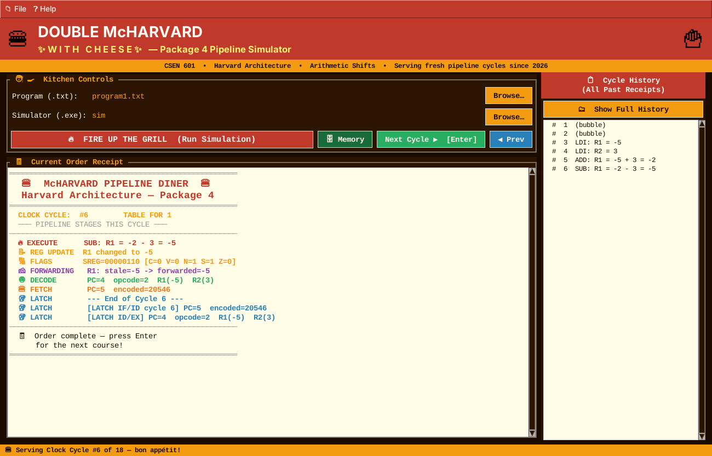
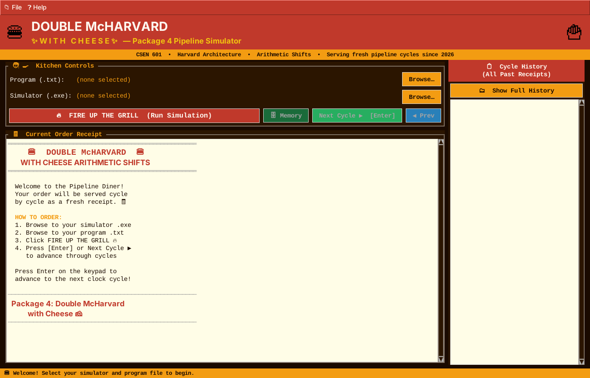
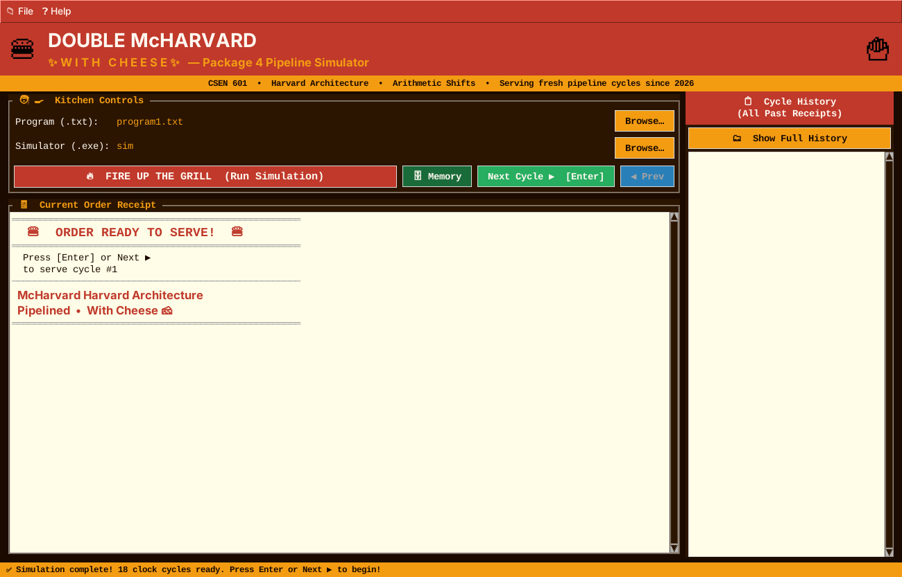
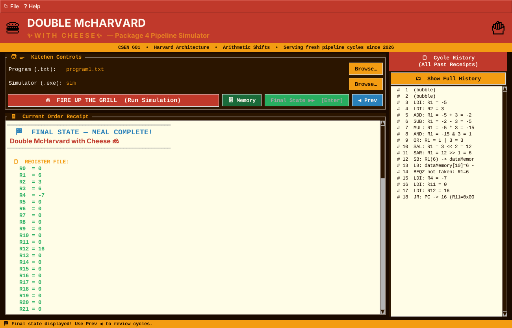
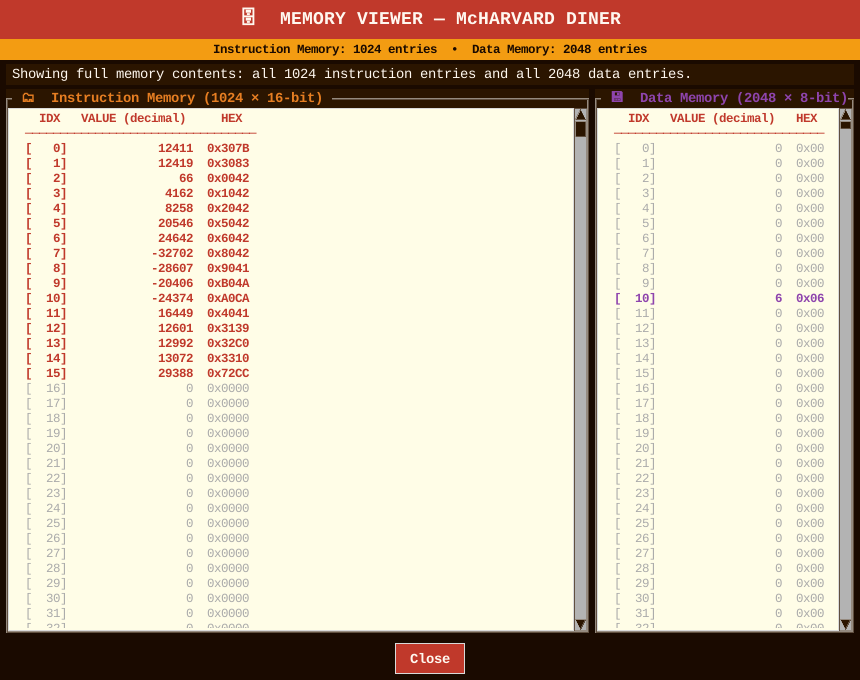
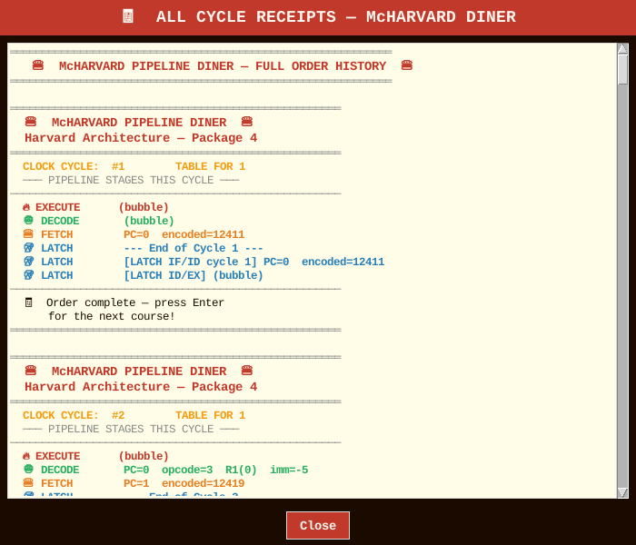

# 🍔 Double McHarvard with Cheese — Pipeline Simulator

A cycle-by-cycle simulator of a small **Harvard-architecture, 3-stage pipelined processor** (Package 4: *Double McHarvard with Cheese*, with arithmetic shifts), written in C, plus a restaurant-themed **Tkinter GUI** that lets you step through every clock cycle like a diner receipt.

Built for **CSEN 601 – Computer Systems Architecture**, Spring 2026, Faculty of Media Engineering and Technology, German University in Cairo.



---

## Table of contents

- [Features](#features)
- [How it works](#how-it-works)
- [Instruction set](#instruction-set)
- [Project structure](#project-structure)
- [Running it on your machine](#running-it-on-your-machine)
- [Writing your own program](#writing-your-own-program)
- [GUI tour](#gui-tour)
- [Contributors](#contributors)

---

## Features

- **Harvard architecture** – separate instruction memory (1024 × 16-bit) and data memory (2048 × 8-bit).
- **64 general-purpose 8-bit registers** (`R0`–`R63`) and a status register (`SREG`) with the flags **C, V, N, S, Z**.
- **3-stage pipeline** (Fetch → Decode → Execute) with two latches (`IF_ID`, `ID_EX`).
- **Data hazard handling** – forwarding from the Execute stage, plus a stall (bubble) for the load-use case after `LB`.
- **Control hazards** – the pipeline is flushed when `BEQZ` is taken or `JR` executes.
- **Assembly parser** that encodes each instruction straight into a 16-bit word; decoding is done later with masking and shifting.
- **GUI** that shows each cycle's pipeline activity, register changes, flags, forwarding, latches, a running cycle history, a memory viewer, and the final machine state.

## How it works

| Component | Description |
|---|---|
| **Parser** (`parser.c`) | Reads `program.txt`, matches each line with `sscanf`, and stores the encoded 16-bit instruction (R-type or I-type) in instruction memory. |
| **Fetch / Decode** (`FD.c`) | Fetch reads `instructionMemory[PC]` and increments PC. Decode extracts opcode, registers and the (sign-extended) 6-bit immediate, and reads the register values. |
| **Execute / ALU** (`execute.c`) | Performs the operation on 8-bit values and updates `SREG`. Supports ADD, SUB, MUL, AND, OR, SAL, SAR. |
| **Memory access** (`memory_WB.c`) | `LB` / `SB` access data memory (the 6-bit immediate limits the reachable addresses to 0–63). |
| **Hazards** (`hazard.c`) | `detectHazard()` and `applyForwarding()` forward the newest result; a stall is inserted for load-use dependencies. |
| **Pipeline** (`pipeline.c`, `main.c`) | Each cycle runs the stages in the order **EX → ID → IF** so a single latch between stages is enough. A program of *n* instructions takes `3 + (n − 1)` cycles (plus extra cycles for stalls/flushes). |

### Status flags

| Flag | Meaning |
|---|---|
| **C** Carry | Set on unsigned 8-bit overflow of an addition |
| **V** Overflow | Signed overflow for ADD and SUB |
| **N** Negative | Bit 7 of the result |
| **S** Sign | `N XOR V` |
| **Z** Zero | Result equals zero |

MUL, AND, OR, SAL and SAR only update **N** and **Z**.

## Instruction set

Instructions are 16 bits: a 4-bit opcode, then either two 6-bit register fields (**R-type**) or a 6-bit register field and a 6-bit signed immediate (**I-type**).

| Opcode | Mnemonic | Type | Syntax | Effect |
|:-:|---|:-:|---|---|
| 0 | `ADD` | R | `ADD R1 R2` | `R1 = R1 + R2` |
| 1 | `SUB` | R | `SUB R1 R2` | `R1 = R1 - R2` |
| 2 | `MUL` | R | `MUL R1 R2` | `R1 = R1 * R2` |
| 3 | `LDI` | I | `LDI R1 imm` | `R1 = imm` |
| 4 | `BEQZ` | I | `BEQZ R1 imm` | If `R1 == 0`, `PC = (address of this instruction) + 1 + imm` (pipeline flushed) |
| 5 | `AND` | R | `AND R1 R2` | `R1 = R1 & R2` |
| 6 | `OR` | R | `OR R1 R2` | `R1 = R1 \| R2` |
| 7 | `JR` | R | `JR R1 R2` | `PC = (R1 << 8) \| R2` (the two register values are concatenated; pipeline flushed) |
| 8 | `SAL` | I | `SAL R1 imm` | Arithmetic shift left by `imm` |
| 9 | `SAR` | I | `SAR R1 imm` | Arithmetic shift right by `imm` (sign preserved) |
| 10 | `LB` | I | `LB R1 addr` | `R1 = dataMemory[addr]` |
| 11 | `SB` | I | `SB R1 addr` | `dataMemory[addr] = R1` |

## Project structure

```
.
├── main.c            # Clock loop, final-state printout
├── defs.h            # Types, constants, globals, prototypes
├── parser.c          # Assembly -> 16-bit encoding
├── FD.c              # Fetch and Decode stages
├── execute.c         # Execute stage + ALU + SREG flags
├── memory_WB.c       # Memory access (LB / SB) and write-back
├── hazard.c          # Hazard detection, forwarding, stalls
├── memory.c          # Instruction / data memory arrays
├── pipeline.c        # Pipeline latches
├── GUI.py            # Tkinter front-end
├── program1.txt      # Sample programs (all instruction types)
├── program2.txt      # ...
├── program3.txt
├── program4.txt
├── sim.exe           # Prebuilt Windows simulator
└── screenshots/      # Images used in this README
```

## Running it on your machine

### Requirements

- A **C compiler** (GCC / MinGW on Windows, GCC or Clang on Linux/macOS)
- **Python 3.8+ with Tkinter** (only needed for the GUI)
  - Windows / macOS: Tkinter ships with the standard python.org installer.
  - Debian / Ubuntu: `sudo apt install python3-tk`
  - Fedora: `sudo dnf install python3-tkinter`

### 1. Get the code

```bash
git clone <your-repo-url>
cd "McHarvard with Cheese Arithmetic Shifts"
```

Or just unzip the project folder and open a terminal inside it.

### 2. Build the simulator

```bash
gcc main.c memory.c parser.c pipeline.c hazard.c memory_WB.c FD.c execute.c -o sim
```

This produces `sim` (Linux/macOS) or `sim.exe` (Windows). A prebuilt `sim.exe` for Windows is already included.

### 3a. Run from the terminal

The simulator always reads a file named **`program.txt`** from the current directory, so copy one of the sample programs to that name first:

```bash
# Windows (cmd / PowerShell)
copy program1.txt program.txt
.\sim.exe

# Linux / macOS
cp program1.txt program.txt
./sim
```

It prints every clock cycle (fetch / decode / execute activity, forwarding, latches) followed by the final register file, `PC`, `SREG`, and the non-zero instruction and data memory.

### 3b. Run with the GUI

```bash
python GUI.py        # or: python3 GUI.py
```

Then, in the window:

1. Click **Browse…** next to *Program (.txt)* and pick a program, e.g. `program1.txt`.
2. Click **Browse…** next to *Simulator (.exe)* and pick the simulator you built (`sim.exe` on Windows, `sim` on Linux/macOS).
3. Click **🔥 FIRE UP THE GRILL (Run Simulation)**.
4. Press **Enter** (or **Next Cycle ▶**) to step through the cycles, **◀ Prev** to go back, and open **Memory** to inspect instruction/data memory.

> The GUI copies the chosen program to `program.txt` next to the simulator before running it, so the simulator must live in a folder you can write to.

## Writing your own program

Create a text file with **one instruction per line**, using the syntax from the [instruction set](#instruction-set). Registers are written `R0`–`R63`; immediates are decimal and signed (−32 to 31, since they are 6-bit). For example (`program1.txt`):

```
LDI R1 -5
LDI R2 3
ADD R1 R2
SUB R1 R2
MUL R1 R2
AND R1 R2
OR R1 R2
SAL R1 2
SAR R1 1
SB R1 10
LB R3 10
BEQZ R1 1
LDI R4 -7
LDI R11 0
LDI R12 16
JR R11 R12
```

## GUI tour

| | |
|---|---|
| **Welcome screen** – choose a program and simulator<br> | **Ready to serve** – simulation finished, press Enter to start<br> |
| **Cycle receipt** – stages, register updates, flags, forwarding and latches for one clock cycle, with a running history on the right<br> | **Final state** – full register file, PC and SREG<br> |
| **Memory viewer** – instruction memory (16-bit) and data memory (8-bit)<br> | **Full cycle history** – every receipt in one scrollable window<br> |

## Contributors

**Team 06** — CSEN 601, Spring 2026

- Haya Bakier
- Yassmin Kamha
- Hana Issa
- Toqa Abdalla
- Shahd Walid
- Layal Maged

**Responsible TA:** Nourhan Elgendy

---

*Thank you for dining at McHarvard! 🧀*
